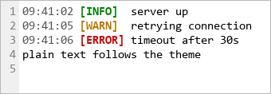
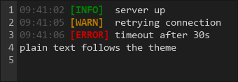

# Themes and colors

The viewer looks right with zero configuration: unstyled text follows the
theme, and explicit SGR colors in the log are never touched. This guide
covers the knobs for when it has to match your app.

## Pick a theme

```python
viewer.setTheme("light")
viewer.setTheme("dark")
# "auto" follows the OS and live-updates on system changes
viewer.setTheme("auto")
```

`theme()` returns the resolved theme (`"light"` or `"dark"`), and
`themeRequested()` returns what you asked for, so `"auto"` stays
distinguishable.

Unstyled text uses black on white in light mode and `#d4d4d4` on `#1e1e1e`
in dark mode, so plain logs always match the background.

<div class="gb-figures" markdown>

<figure class="gb-figure" markdown>
{ width="340" }
<figcaption><code>setTheme("light")</code></figcaption>
</figure>

<figure class="gb-figure" markdown>
{ width="340" }
<figcaption><code>setTheme("dark")</code></figcaption>
</figure>

</div>

## Fix the default colors

To use your own pair instead of the theme's, set it explicitly. This stops
default colors following the theme until you turn that back on:

```python
from PySide6.QtGui import QColor

viewer.setDefaultColors(QColor("#e4e8df"), QColor("#121612"))
viewer.setColorsFollowTheme(True)  # back to automatic
```

!!! note "Background is per text run"
    The default background colors the text itself, not the widget behind it.
    Pick a theme whose base is close to your background (here `"dark"`), or
    the text shows as dark bands on a light widget.

## Change the ANSI palette

The eight base colors (0 to 7: black, red, green, yellow, blue, magenta,
cyan, white) can be replaced one by one, for the normal (30 to 37) or the
bright (90 to 97) variants:

```python
viewer.setAnsiPaletteColor(1, QColor(220, 50, 47))               # red
viewer.setAnsiPaletteColor(1, QColor(255, 85, 85), bright=True)  # bright red
viewer.resetAnsiPalette()
```

`ansiPalette()` returns only your overrides, keyed by `(index, bright)`.
256-color and truecolor sequences are drawn exactly as the log specifies.

## Log levels, search, bookmarks

`setLogLevelColors()` replaces the whole level map, so merge into the
current one to change a single level:

```python
colors = viewer.logLevelColors()
colors["ERROR"] = QColor(200, 0, 0)
viewer.setLogLevelColors(colors)
viewer.setLogLevelHighlighting(True)
```

Search matches and bookmarks take translucent backgrounds, so the text
color underneath stays readable:

```python
viewer.setSearchHighlightColor(
    QColor(255, 255, 0, 100),  # every match
    QColor(255, 140, 0, 160),  # the active match
)
viewer.setBookmarkColor(QColor(140, 180, 255, 90))
```

## Fonts

The viewer starts on the system fixed font at 10pt. `setFontFamily()` keeps
the size, `setFontSize()` also sets the size `resetZoom()` returns to after
++ctrl++ + wheel zooming, and `useSystemFont()` takes a one-shot snapshot of
the application font. Monospace
is the default for a reason: proportional fonts render fine, but columns stop
lining up. See [System fonts](../gallery.md#system-fonts).

The full list of setters and getters is in
[Theme & colors](../api/viewer.md#theme-colors) and
[Fonts & zoom](../api/viewer.md#fonts-zoom).
