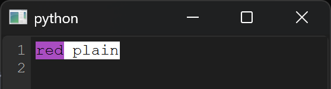
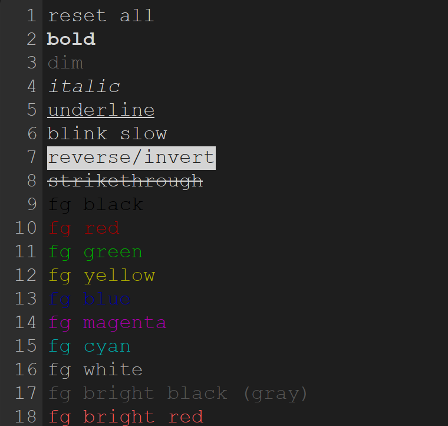

---
social:
  cards_layout_options:
    title: ANSI log viewer for Qt for Python
---

# QAnsiTextViewer

A Qt log-viewer widget for Python that renders ANSI escape codes and colored
terminal output — tail logs, search them, bookmark lines, and save sessions,
all behind a typed one-widget API. Built on PySide6 (and compatible with PyQt),
it parses SGR, 256-color, and truecolor sequences, handles `\r` progress lines,
and stays responsive through 100k-line bursts via chunked async appends.
{ .gb-lede }

## Quick start

<div class="gb-split" markdown>

```python title="quickstart.py" linenums="1"
from PySide6.QtWidgets import QApplication
from ansi_text_viewer import AnsiTextViewer

app = QApplication([])
viewer = AnsiTextViewer()
viewer.appendAnsiText("\x1b[31mred\x1b[0m plain\n")
# F3 / Shift+F3 navigates, Esc clears
viewer.highlight_search("red")
viewer.setTheme("dark")
viewer.show()
app.exec()
```

<div class="gb-figures" markdown>

<figure class="gb-figure" markdown>
{ width="420" }
<figcaption>That snippet renders this: the red ANSI text, lit up as the search match.</figcaption>
</figure>

<figure class="gb-figure" markdown>
{ width="380" }
<figcaption>The demo's Test ANSI Colors output: styles and foreground colors, each line terminated so nothing bleeds. <a href="gallery/#ansi-colors-isolated-per-line">Visual tour</a></figcaption>
</figure>

</div>

</div>

## Install

=== "uv"

    ```bash
    uv add qansitextviewer
    ```

=== "pip"

    ```bash
    pip install qansitextviewer
    ```

=== "github / local"

    ```bash
    uv add git+https://github.com/tanishq-kumar/QAnsiTextViewer
    # or: uv build && uv pip install dist/qansitextviewer-*.whl
    ```

Requires Python `>=3.11` and PySide6 `>=6.5.0`.


## Next

<div class="gb-next" markdown>

- [Your first log pane](guides/first-log-pane.md) Put the viewer in a window with a search box, match counter, and filter.
- [Streaming process output](guides/streaming.md) Tail a subprocess, dump huge logs without freezing, pause and resume.
- [Themes and colors](guides/theming.md) Light, dark, OS-following auto, plus custom ANSI palettes.
- [Viewer API](api/viewer.md) Every method, signal, and shortcut, with examples.

</div>

## What it does

| Feature | In short |
| ------- | -------- |
| **Search & filter** | Highlight with regex, jump with ++f3++, hide non-matching lines. |
| **Bookmarks** | Gutter click, list panel, next/previous navigation, saved in sessions. |
| **Themes** | Light, dark, OS-following auto, plus custom ANSI palettes. |
| **Non-blocking** | Chunked async appends keep the UI alive through 100k-line bursts. |

!!! tip "Try the demo"
    `just demo` launches the full showcase: streaming logs, progress bars,
    bookmarks, sessions, themes, and palette pickers. Prefer pictures?
    [Take the visual tour](gallery.md) — every feature annotated.

## API reference

| Page | Contents |
| ---- | -------- |
| [Viewer](api/viewer.md) | `AnsiTextViewer` — every method, with examples |
| [Highlighting](api/highlighting.md) | `Span`, `HighlightRule`, all built-in rules |
| [Internals](api/internals.md) | ANSI decoding, search engine, gutter |

!!! warning "Untrusted logs"
    Log content is untrusted by design. Links open only on ++ctrl++ + click,
    cursor jumps are clamped, and huge lines are truncated. For hostile
    logs, call `viewer.setLinksEnabled(False)`.

## Why QAnsiTextViewer?

- **`QPlainTextEdit` + hand-rolled parsing** — the default DIY route. You end
  up re-implementing SGR tables, `\r` handling, search, and themes. This
  widget is that work, finished and tested.
- **Terminal emulator widgets** (e.g. QTermWidget-based) — built for
  interactive shells, heavy to embed, and poor at search/bookmarks/export.
  This is a read-oriented log viewer instead.
- **Web views** — rendering logs as HTML in `QWebEngineView` works but drags
  in a browser engine for colored text. Native Qt stays light.

## FAQ

??? question "Does it work with PyQt?"
    PySide6 is the tested dependency, but the widget only uses the shared Qt
    `QWidget` API, so PyQt6/PyQt5 work with no code changes. Report gaps as bugs.

??? question "Can I use it outside Python?"
    No — it is a Python class (via Qt for Python) and cannot be imported from
    C++, Rust, or other languages. The ANSI parser module is deliberately kept
    free of widget imports so a future port only re-implements that core.

??? question "How large can logs get?"
    `setMaximumBlocks()` caps memory (oldest blocks are discarded) and
    `setMaxLineLength()` truncates hostile lines. The performance notes in
    [Internals](api/internals.md) cover the 100k-line burst path.
